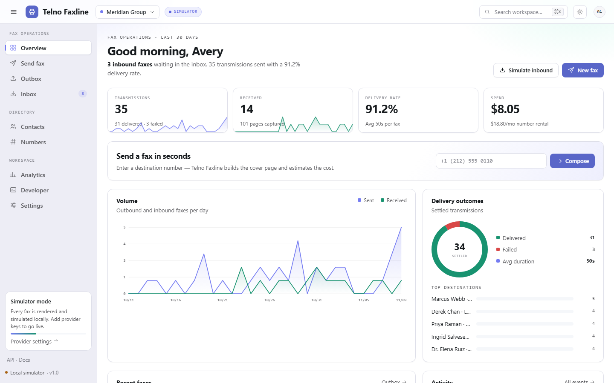
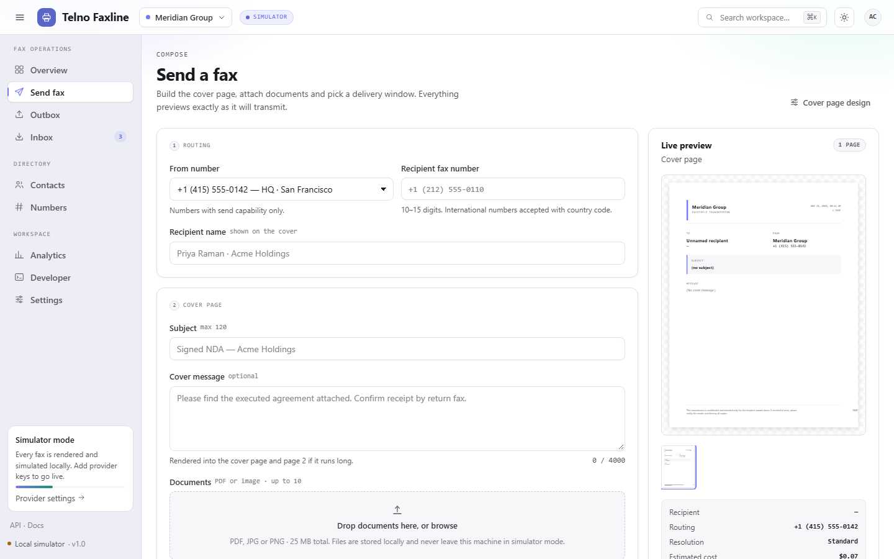

# Telno Faxline

[](https://github.com/innotelinc/telno-faxline/actions/workflows/ci.yml)

An all-in-one fax platform: compose, transmit, receive, and audit faxes from one
interface — with a server-rendered document engine, live status streaming, an
API, and pluggable provider adapters.

Telno Faxline runs on **Node.js 22.5+ with zero npm dependencies**. Persistence
uses the built-in `node:sqlite` module, so `npm start` is the whole install step.

```bash
npm start          # http://127.0.0.1:4321
npm run dev        # same, with --watch
npm run check      # syntax-check the server modules
```

The first boot seeds a 30-day demo workspace (numbers, contacts, 49 faxes,
activity log) so every screen is populated immediately.

## Tests

```bash
npm test
```

The suite boots a real server on an ephemeral port with its working directory
pointed at a throwaway folder, so it exercises a fresh SQLite database without
touching `data/`. It then drives the HTTP API end to end: bootstrap and stats,
fax creation, validation, page rendering and PDF export, document upload and
attachment, contacts, number provisioning, API keys and scopes, settings
validation, signed provider webhooks, forced simulator failures, inbound
simulation, and demo reset. No fixtures, credentials, or network access are
needed; CI runs it on every push and pull request alongside the syntax checks.

## Screenshots





## What it does

| Area | Capabilities |
| --- | --- |
| Compose | Cover page + attachments, drag-free uploads (PDF/JPG/PNG), reorder, live page preview, page count and cost estimate, quality tiers (standard/fine/ultra), scheduling, retry budget, tags, priority |
| Outbox | Status state machine (`queued → sending → delivered/failed/cancelled`), live updates over SSE, timeline, retry, cancel, download PDF, star, delete |
| Inbox | Received faxes with unread tracking, page previews, PDF download, forwarding notes |
| Directory | Contacts with groups/favourites and fax autocomplete; DID management with capabilities, regions, inbound volume, default-number selection |
| Analytics | Volume series, success rate, pages, spend, top destinations, busiest hours, 7/30/90-day windows |
| Developer | API keys (hashed at rest), REST reference with copyable cURL, signed outgoing webhooks with a delivery log, inbound provider callback endpoint, simulator controls |
| Settings | Workspace identity, cover-page designer with live preview, retention, notification preferences, theme and density |

Cross-cutting: command palette (`⌘K` / `Ctrl K`), keyboard shortcuts (`g` then
`o`/`i`/`s`/`c`, `/` to search, `?` for help), toasts, accessible focus states,
`prefers-reduced-motion` support, and a responsive shell down to mobile.

## Architecture

```
server.js              HTTP server: static SPA, security headers, API delegation
server/api.js          Route table, validation, public API v1, provider callbacks
server/engine.js       Fax state machine, scheduling, retries, inbound simulation
server/store.js        SQLite schema, repositories, analytics, demo seed
server/render.js       One page model → SVG preview + dependency-free PDF writer
server/providers.js    Adapter registry (simulator / Telnyx / custom HTTP)
server/webhooks.js     HMAC-signed outgoing webhook delivery + delivery log
server/hub.js          Server-sent-events broadcast hub
web/                   Dependency-free ES-module SPA (tokens, views, components)
data/faxline.db        SQLite database (created on first run)
data/files/            Uploaded document bytes
```

Every fax stores an immutable `render` snapshot at send time, so previews and
PDF downloads never change when workspace settings change later.

### Data model

`settings` (key/value), `numbers`, `contacts`, `faxes`, `files`, `api_keys`,
`events`, `deliveries`. Fax rows carry JSON columns for `documents`, `timeline`,
and `render`.

## Plug and play: providers

The platform works with no account at all. `server/providers.js` exposes one
interface — `send({ fax, files, callbackUrl })` — and picks an adapter from the
environment:

| `FAX_PROVIDER` | Mode | Required env | Notes |
| --- | --- | --- | --- |
| `simulator` (default) | simulated | — | Renders locally, advances status on timers, ~6% synthetic failures, honours "fail next" |
| `telnyx` | live | `TELNYX_API_KEY`, `TELNYX_CONNECTION_ID` | POSTs the rendered PDF to Telnyx Programmable Fax v2; status arrives by webhook |
| `webhook` | live | `FAX_SEND_URL` (+ optional `FAX_SEND_TOKEN`, `FAX_CANCEL_URL`) | POSTs a JSON envelope with the base64 document to your own gateway |

Also used when live: `FAX_FROM_NUMBER` (override sender), `PUBLIC_BASE_URL`
(callback URL handed to providers), `FAX_WEBHOOK_SECRET` (verifies inbound
provider callbacks; falls back to the workspace webhook secret).

If a live provider is requested but not configured, Telno Faxline falls back to
the simulator and says so on the Developer page — no silent failures, no
crashes.

Provider callbacks: `POST /api/webhooks/provider` with
`X-Faxline-Signature: sha256=<hmac>` over the raw body. Accepted statuses map to
`delivered`, `failed`, `cancelled`, or `sending`.

## API

The UI uses `/api/*` directly. Machine clients use `/api/v1/*` with a key from
the Developer page:

```bash
curl -H "Authorization: Bearer fx_live_…" http://127.0.0.1:4321/api/v1/faxes

curl -X POST http://127.0.0.1:4321/api/v1/faxes \
  -H "Authorization: Bearer fx_live_…" -H "Content-Type: application/json" \
  -d '{"to":"+1 212 555 0110","subject":"Signed NDA","note":"Attached.","documentIds":[]}'
```

Keys are stored as SHA-256 hashes; the secret is shown exactly once at creation.
Live updates stream from `GET /api/stream` (`fax.created`, `fax.updated`,
`fax.delivered`, `fax.failed`, `fax.received`, `stats.stale`).

## Honest limitations

- The simulator does not touch the PSTN; nothing is transmitted anywhere.
- The built-in PDF writer renders text and shape layers. Uploaded PDFs are stored
  byte-for-byte and sent to live providers, but the preview draws an attachment
  page rather than rasterising the original PDF (no PDF rasteriser is bundled).
  Image attachments are previewed from their stored bytes.
- There is no multi-user login: this is a single-workspace local deployment.
  Deploy behind your own access control before exposing it beyond localhost.
- Webhook delivery is a single attempt; the delivery log records the outcome.
- Retention settings are stored and surfaced in the UI, but no automatic purge
  job runs yet.
- The SQLite file and the outbound signature header keep their original
  `faxline` names so existing databases and provider integrations keep working.
